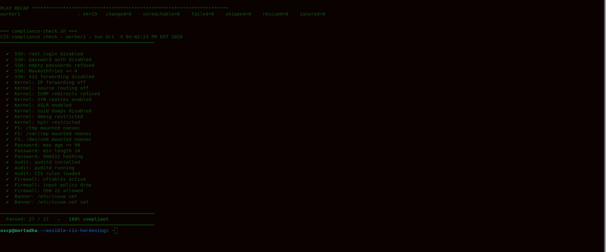

# CIS Hardening with Ansible

A Debian 13 hardening role covering 27 CIS controls, with a compliance report before and after — and an idempotence test, because a role that changes something on every run cannot be scheduled.

---

## Result

```
  Passed: 27 / 27   —  100% compliant      ← after the role
```

Every control in scope is applied and verified by reading actual system state — not by trusting Ansible's report.

The compliance script checks the system independently of the playbook. A green `PLAY RECAP` only proves Ansible *thought* it succeeded. Reading `/etc/ssh/sshd_config`, `sysctl`, `mount`, `nft list ruleset` and `auditctl -l` afterwards proves it actually did.

---

## Idempotence

```
$ ansible-playbook site.yml | tail -3
PLAY RECAP
worker1 : ok=29  changed=0  unreachable=0  failed=0  skipped=0

$ ansible-playbook site.yml | tail -3
PLAY RECAP
worker1 : ok=29  changed=0  unreachable=0  failed=0  skipped=0
```

Zero changes on every run. That's idempotence, and it's the property that separates a role from a script. A script you run once. A role reporting `changed=0` is one you can schedule hourly and forget about — and if it ever reports changes, something drifted and you want to know.

Getting there required replacing three `command: mount -o remount` tasks with `ansible.posix.mount`. The `command` module cannot know whether the remount is already in effect, so it reported `changed=3` on every run. The `mount` module compares current mount options against the desired ones and only acts when they differ.

```

## What it covers

| Area | Controls |
|---|---|
| **SSH** | Root login, password auth, empty passwords, MaxAuthTries, X11 forwarding |
| **Kernel** | 8 sysctl parameters — IP forwarding, source routing, ICMP redirects, SYN cookies, ASLR, suid dumps, dmesg restriction, kptr restriction |
| **Filesystem** | /tmp, /var/tmp, /dev/shm mounted with `noexec,nosuid,nodev` |
| **Passwords** | Complexity via pwquality (minlen 14), ageing policy (max 90 days), SHA512 hashing |
| **Audit** | auditd installed, running, 9 CIS rules loaded (identity, logins, mounts, time-change) |
| **Firewall** | nftables with default drop on input, SSH 22 allowed, loopback allowed |
| **Banner** | Legal warning on /etc/issue and /etc/issue.net |

---

## Two design decisions worth explaining

### SSH configuration is validated before it's written

```yaml
lineinfile:
  path: /etc/ssh/sshd_config
  regexp: '^#?\s*{{ item.key }}\s'
  line: '{{ item.key }} {{ item.value }}'
  validate: '/usr/sbin/sshd -t -f %s'
```

Ansible writes to a temporary file, runs `sshd -t` against it, and only replaces the real config if the syntax is valid.

Without this, a typo in a directive produces a config that sshd refuses to load. The service fails to restart, and you have just locked yourself out of the machine you were securing. On a remote host with no console access, that's unrecoverable.

The `regexp: '^#?\s*{{ item.key }}\s'` also matters — it matches both commented (`#X11Forwarding yes`) and uncommented (`X11Forwarding yes`) lines, so Ansible replaces the directive in place instead of appending a duplicate at the end of the file. In `sshd_config`, the *first* occurrence wins, so an appended line would silently be ignored.

### Firewall: the FORWARD chain matters on Kubernetes nodes

```nft
chain forward {
  type filter hook forward priority 0;
  policy drop;
  ct state established,related accept
}
```

The `ct state established,related accept` line is not cosmetic. This host runs kubelet — and pod-to-pod traffic transits the FORWARD chain. A bare `policy drop` would break cluster networking silently. The rule lets established flows through while still dropping new unsolicited forwarded packets.

---

## A note on the audit rules

The rules file ends with `-e 2`:

```
-a always,exit -F arch=b64 -S init_module -S delete_module -k modules
-e 2
```

This locks the audit configuration until the next reboot. An attacker who gains root cannot disable auditing to cover their tracks — they'd have to reboot the machine, which is itself an event worth alerting on.

---

## Running it

```bash
git clone https://github.com/Mortadha1996/ansible-cis-hardening
cd ansible-cis-hardening

# edit inventory.ini with your target host

# see what would change, change nothing
ansible-playbook site.yml --check --diff

# apply
ansible-playbook site.yml

# apply only one area
ansible-playbook site.yml --tags ssh
```

### Measuring compliance

```bash
scp scripts/compliance-check.sh user@host:/tmp/
ssh user@host "bash /tmp/compliance-check.sh"
```

The script checks 27 controls independently of Ansible — it reads the actual system state rather than trusting that the playbook did what it claimed.


---

## Author

**Mortadha Riahi** — Infrastructure & Platform Engineer

Red Hat Certified Engineer in Ansible · Red Hat Certified Advanced System Administrator in Ansible · RHCE · RHCSA · ISO 27001

[LinkedIn](https://www.linkedin.com/in/mortadha-riahi/)
